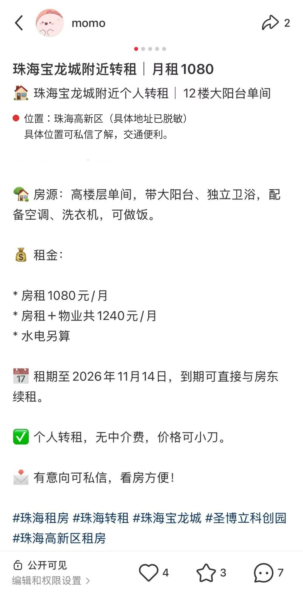
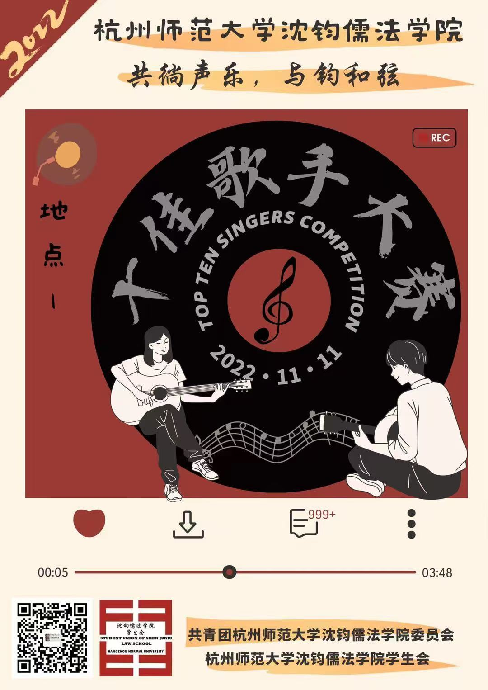
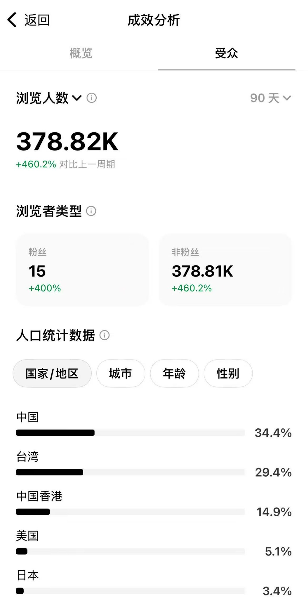
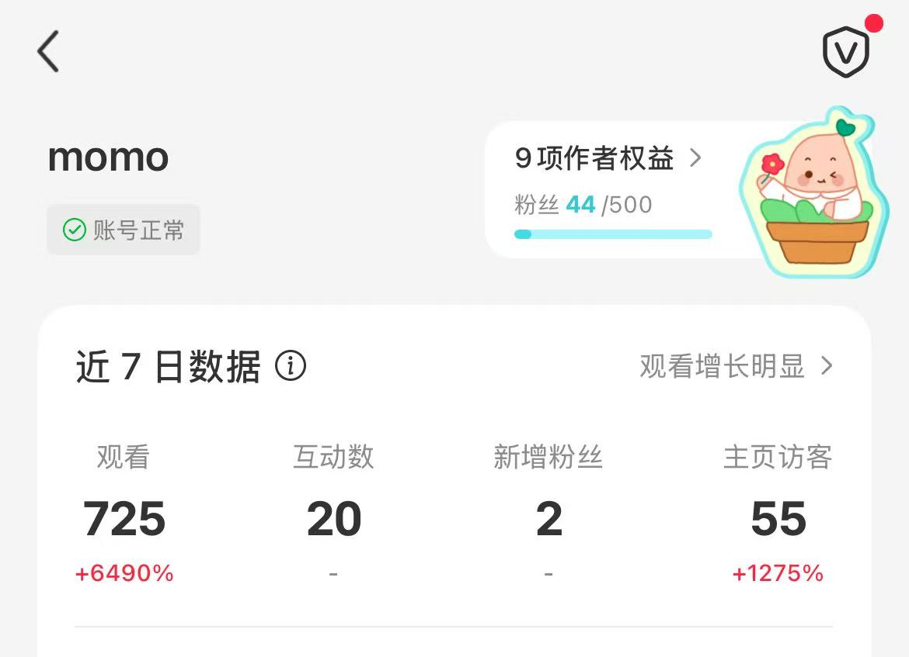
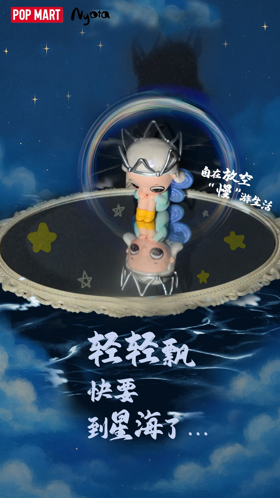

<!DOCTYPE html>
<html lang="zh-CN">
<head>
  <meta charset="UTF-8">
  <meta name="viewport" content="width=device-width, initial-scale=1.0">
  <meta name="description" content="田舍儿的个人简历与作品集，涵盖AI工具实践、内容运营、AIGC视频、视觉设计与项目协同。">
  <meta name="theme-color" content="#f4f1e9">
  <title>田舍儿｜个人简历与作品集</title>
  
</head>
<body>
  <header class="wrap nav">
    <a class="brand" href="#top" aria-label="回到首页">田田舍儿 / PORTFOLIO</a>
    <nav class="navlinks" aria-label="主导航">
      <a href="#about">关于我</a><a href="#experience">经历</a><a href="#work">作品集</a><a href="#contact">联系</a>
    </nav>
  </header>

  <main id="top" class="wrap">
    <section class="hero">
      

        
 Personal profile · 2026

        <h1>把想法拆成问题， 再把问题推进到落地。</h1>
        
你好，我是田舍儿。我的经历横跨项目协调、内容表达与 AI 工具实践。我喜欢把模糊的想法梳理成清晰的需求，用研究、沟通和持续迭代，让事情一步步向前。

        

          <a class="btn primary" href="#work">浏览作品集 ↘</a>
          <a class="btn ghost" href="#experience">查看经历</a>
        

      

      

        

        

          <small>MY WORKING PRINCIPLE</small>
          <h2>Research. Make. Improve.</h2>
          
先理解问题，再动手验证；边做边复盘，逐步改进。

          
项目协同内容表达AI实践

        

        
<strong>150+</strong>项目协调覆盖管理人

      

    </section>

    

      
<strong>150+</strong>管理人合规审查与走访协调

      
<strong>100+</strong>独立撰写评估报告

      
<strong>30%</strong>团队业务响应效率提升（项目经历描述）

      
<strong>61K+</strong>单篇内容浏览量

    

    <section id="about">
      

        

01 / About
<h2 class="section-title">关于我</h2>

        
法律训练给了我检索、分析与细节意识；实践经历让我更关注协作、用户需求和结果交付。

      

      

        <article class="panel dark">
          <h3>个人简介</h3>
          
杭州师范大学知识产权专业本科毕业。做过法律与合规项目，也尝试用 AI 工具制作互动网页、整理内容创作流程。希望继续探索 AI 产品、内容运营、项目执行等方向。

          

            信息检索与研究文稿撰写多方沟通台账与流程管理AI辅助创作内容整理
          

        </article>
        <article class="panel">
          <h3>教育背景</h3>
          

            

              
2022.09 — 2026.06

              
<h3>杭州师范大学 · 知识产权</h3>
本科｜优秀毕业生、学业优秀奖、校级奖学金、智仁奖学金、校三好学生等。

            

            

              
能力关键词

              
<h3>研究、表达、协调、执行</h3>
熟练使用 Office 办公软件；有法律数据库检索、数据整理、材料核对、标准化流程与 AI 工具辅助创作实践。

            

          

        </article>
      

    </section>

    <section id="experience">
      

        

02 / Experience
<h2 class="section-title">经历与实践</h2>

        
从复杂信息中抓重点、协调多方推进进度，并尽可能把过程沉淀成清晰的材料与流程。

      

      <article class="panel">
        

          

            
2026.01 — 2026.05

            
<h3>植德律师事务所｜投融资并购与投资基金助理</h3>
统筹协调北京基金小镇委托的 150+ 家管理人合规审查与实地走访；独立撰写 100+ 份评估报告。通过多维表格跟踪项目进度，参与标书与申报材料制作、商务文件核对及 SOP 梳理。

          

          

            
2024.06 — 2024.09

            
<h3>浙江亿维律师事务所｜知识产权实习生</h3>
跟进 50 余件版权与商标侵权案件，参与电商平台及线下取证，制作 25+ 份证据清单，协助推进材料整理、立案与递送。

          

          

            
门店 / 活动实践

            
<h3>无印良品兼职、Livehouse 艺人志愿者</h3>
参与商品库存盘点、补货、货架陈列调整与庆典活动准备；协助艺人周边商品陈列、介绍产品并引导顾客购买。

          

          

            
校园 / 其他实践

            
<h3>新宣部、志愿服务与线上房源运营</h3>
参与校园活动拍摄与新闻宣传；开展口述访谈、图书整理及暑期“三下乡”实践，负责现场记录、素材汇总与资料归档；参与出租房源线上运营与租赁沟通。

          

        

      </article>
    </section>

    <section id="work">
      

        

03 / Selected work
<h2 class="section-title">作品集</h2>

        
包含自主尝试、内容案例与创作练习。尚未公开上线的项目会明确标注为原型或实践，不将练习包装成商业项目。

      

      

        <article class="project">
          
AI × INTERACTIVE
把一个解谜想法 变成可体验的原型
⌘

          

            
自主原型实践需求拆解迭代

            <h3>AI 解谜游戏网站</h3>
            
从个人想玩的解谜体验出发，尝试将想法描述给 AI，逐步梳理需求，并根据初版体验继续调整。实践重点是如何把模糊创意说清楚，再通过反馈推动版本改进。

            
项目说明 · 原型链接待补充01

          

        </article>

        <article class="project">
          
STORY × WEB
用论坛体组织故事 让线索逐步浮现
✳

          

            
自主尝试内容结构AI辅助

            <h3>论坛体写作网站</h3>
            
尝试把群像叙事、论坛讨论与抽丝剥茧的阅读体验整理成网页项目，并借助 AI 梳理需求、调整内容呈现。希望探索内容结构如何影响读者理解与参与。

            
项目说明 · 演示链接待补充02

          

        </article>

        <article class="project">
          

            
          

          

            
小红书房源推广信息组织

            <h3>小红书房源推广案例</h3>
            
围绕房源位置、租金与物业费、房间配置、租期和续租方式整理笔记，突出用户决策所需信息，并设置私信咨询入口。以下互动为截图记录时的数据。

            

<strong>4</strong>点赞

<strong>3</strong>收藏

<strong>7</strong>评论

<strong>2</strong>分享

            
实际发布内容 · 地址已脱敏03

          

        </article>

        <article class="project">
          
<video controls preload="metadata" poster="ad-edit-cover.jpg" aria-label="广告视频剪辑作品"><source src="ad-edit.mp4" type="video/mp4">当前浏览器暂不支持视频播放。</video>

          

            
广告剪辑视频内容成片展示

            <h3>广告视频剪辑作品</h3>
            
展示实际广告剪辑成片。后续可补充项目背景、目标受众、使用工具及本人具体负责的剪辑环节，进一步说明从素材到成片的工作过程。

            
实际视频 · 可直接播放04

          

        </article>

        <article class="project">
          

          

            
校园视觉设计海报 / 排版

            <h3>校园歌手比赛视觉设计</h3>
            
以“共徜声乐，与钧和弦”为主题，整合活动信息、音乐元素与复古唱片视觉，呈现校园活动宣传物料。点击图片可查看原图。

            
实际海报作品 · 点击查看原图05

          

        </article>

        <article class="project">
          
RESEARCH & WRITING
把资料整理成 清晰的结论与建议
✎

          

            
研究写作数据分析信息整理

            <h3>法律调研与实证分析</h3>
            
省级法律职业能力竞赛获二等奖；校级法学写作大赛获一等奖。曾基于 103 份司法裁判进行分析，并完成调研报告与制度优化建议，体现资料检索、结构化分析和文稿交付能力。

            
研究案例 · 可面试讲解06

          

        </article>
      

        <article class="project">
          

            
            
          

          

            
平台运营数据观察受众分析

            <h3>平台运营数据记录</h3>
            
根据两组后台截图整理账号表现，关注浏览、互动、粉丝增长、主页访问与受众地区。因截图未明确显示平台名称，两组数据按各自统计周期分别呈现，不直接合并。

            

              
<strong>378.82K</strong>截图A · 近90天浏览人数

              
<strong>460.2%</strong>截图A · 较上一周期增长

              
<strong>725</strong>截图B · 近7日观看

              
<strong>20</strong>截图B · 互动数

              
<strong>2</strong>截图B · 新增粉丝

              
<strong>55</strong>截图B · 主页访客

            

            
平台后台截图 · 周期分别标注07

          

        </article>
        <article class="project">
          

          

            
视觉创作潮玩内容社交媒体素材

            <h3>潮玩主题视觉创作</h3>
            
以潮玩产品为主体，结合星空背景、倒影、装饰图形与文字排版进行画面呈现，展示产品内容的视觉包装与社交平台素材制作实践。

            
实际视觉作品 · 点击查看原图08

          

        </article>

      
作品集说明：海报、平台数据截图、房源笔记及广告视频为实际素材；房源截图中的具体地址已脱敏。两组平台数据的名称与统计口径尚未确认，按原截图分别展示。AI 解谜游戏与论坛体写作网站暂未补充公开演示链接。

    </section>

    <section id="contact">
      

        

          
04 / Contact

          <h2>有具体的问题， 就从一次沟通开始。</h2>
          
欢迎交流 AI 工具、内容运营、项目协同与创意落地相关机会。联系方式可在确认后补充，避免公开未经核实的信息。

        

        联系方式待补充
      

    </section>
  </main>

  <footer class="wrap">
    © 2026 田舍儿 · 个人简历与作品集
    
<a href="#top">返回顶部 ↑</a><a href="https://xhslink.com/m/6SkrfOnMPNp" target="_blank" rel="noopener noreferrer">小红书主页 ↗</a>

  </footer>
</body>
</html>
